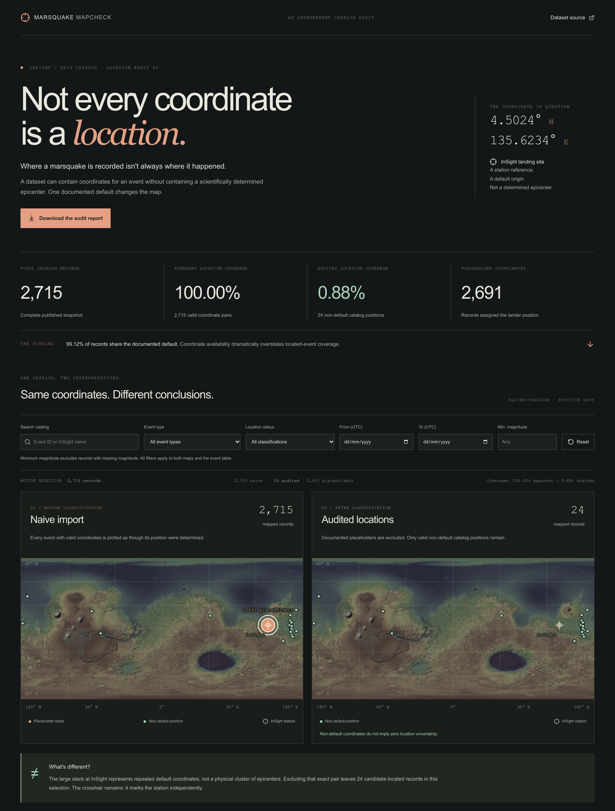
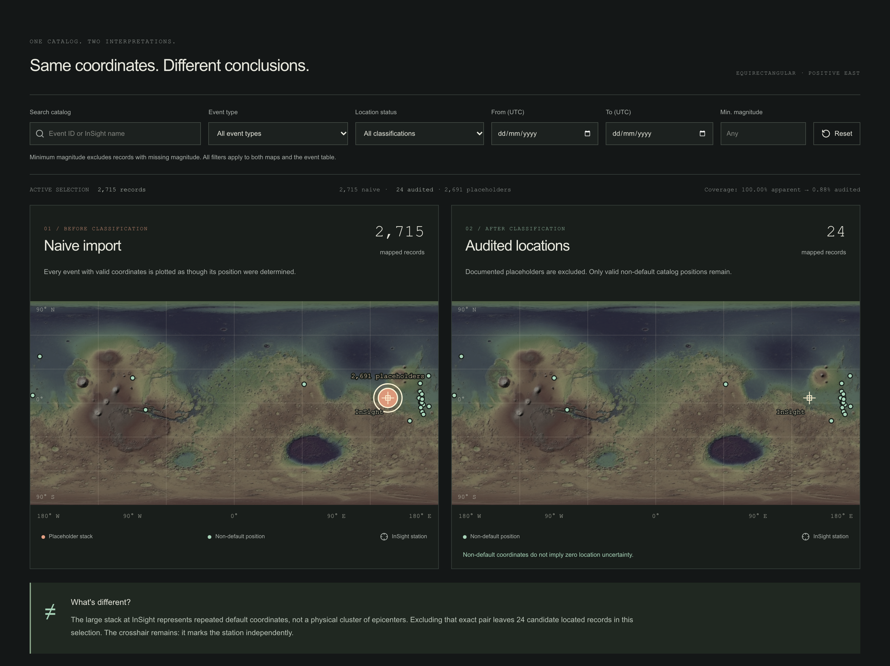
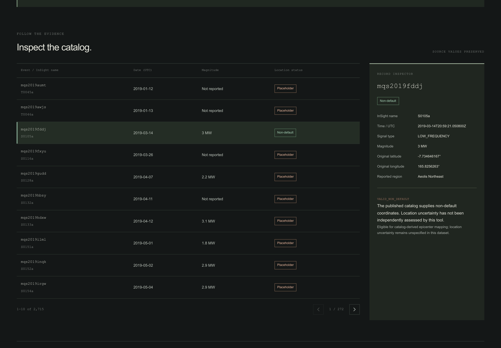
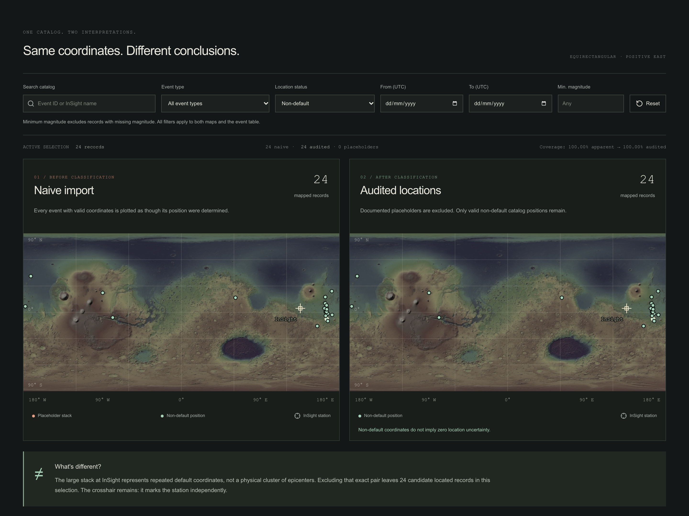
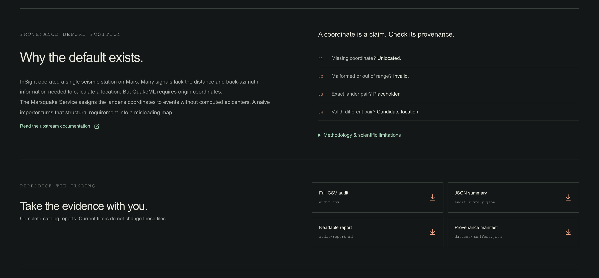
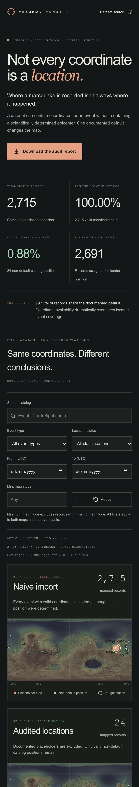
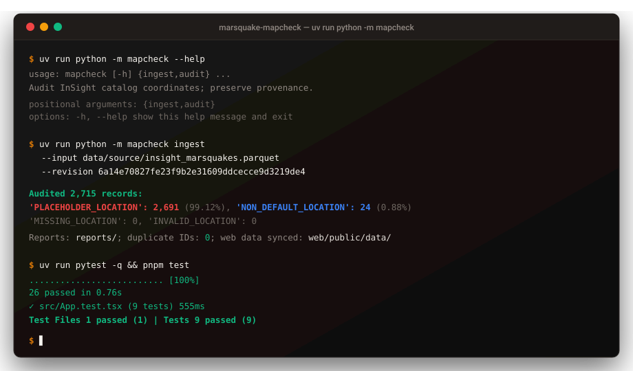

# Marsquake MapCheck

**Not every coordinate is a location.**

> **A provenance-aware audit of placeholder coordinates in NASA InSight's Marsquake catalog, comparing naive coordinate plotting with an audited, scientifically accurate Mars map.**

A focused scientific data-quality instrument for the InSight Marsquake Service catalog. A Python audit engine preserves source data while explaining every location classification, and an interactive React web application visualizes the critical distinction between structural database coordinates and scientifically determined epicenters.

[](docs/screenshots/overview.png)

---

## The Scientific Problem

The [Marsquake Service (MQS) documentation](https://service.earthscope.org/irisws/mars-event/docs/1/help/) explains that valid QuakeML origins require coordinate pairs. Events recorded by InSight's single seismic station that lack the distance and back-azimuth data needed to calculate an epicenter are assigned the InSight lander coordinates: **4.5024° N, 135.6234° E**.

In derivative distributions—such as the popular [Hugging Face InSight Marsquake Catalog](https://huggingface.co/datasets/juliensimon/insight-marsquake-catalog)—all 2,715 records are labeled as having "location estimates", and simple checks like `latitude.notna()` are suggested to identify located marsquakes. This checks data structure, not scientific truth.

A naive visualization creates a massive, false cluster of 2,691 marsquakes at the lander site. **Marsquake MapCheck** audits these coordinates without discarding or rewriting the original catalog data.

---

## Audit Findings at a Glance

Derived deterministically from the bundled InSight Parquet snapshot (revision `6a14e70827fe23f9b2e31609ddcecce9d3219de4`):

| Finding                             |   Metric   | Percentage / Significance                   |
| :---------------------------------- | :--------: | :------------------------------------------ |
| **Total Catalog Records**           |  `2,715`   | Complete published snapshot                 |
| **Valid Coordinate Pairs**          |  `2,715`   | 100% syntactically valid coordinates        |
| **Documented Placeholder Pairs**    |  `2,691`   | **99.12%** assigned to InSight landing site |
| **Valid Non-Default Epicenters**    |    `24`    | **0.88%** candidate computed locations      |
| **Missing / Malformed Coordinates** |  `0 / 0`   | Zero unparseable records                    |
| **Duplicate Event Identifiers**     |    `0`     | Clean identifier namespace                  |
| **Apparent Location Coverage**      | `100.00%`  | Naive interpretation                        |
| **Audited Location Coverage**       |  `0.88%`   | Provenance-aware interpretation             |
| **Reduction in Apparent Coverage**  | **99.12%** | True scientific correction                  |

> **Note on Seismological Meaning:** Non-default coordinates represent candidate computed positions under MQS conventions; location uncertainty is not supplied in this dataset. The station crosshair remains an independent spatial reference in both map views.

---

## Visual Showcase & Feature Tour

### 1. Side-by-Side Map Comparison

Both maps use the exact same global equirectangular projection, USGS MOLA topographic raster basemap, planetocentric latitude, and positive-east coordinates. The naive view plots all 2,715 records as if they were epicenters; the audited view isolates the 24 candidate locations across Elysium Planitia, Cerberus Fossae, and beyond.



### 2. Deep Catalog Record Inspector

Selecting any map marker or table row opens the Record Inspector. Source coordinates, contributor IDs, event types, UTC timestamps, and magnitudes are presented alongside explicit audit codes (e.g., `MQS_LANDER_DEFAULT` vs. `VALID_NON_DEFAULT`) and recommended scientific actions.



### 3. Synchronized Interactive Filtering

Search by event ID or contributor name, filter by signal type (e.g., `BROADBAND`, `LOW_FREQUENCY`, `2.4_HZ`), constrain UTC date ranges, or apply a minimum magnitude threshold. Both maps, selection metrics, and the pagination view update synchronously.



### 4. Transparent Methodology & Artifact Downloads

Every finding is verifiable. The application includes immediate downloads for full per-record CSV audits, JSON summaries, human-readable markdown reports, and cryptographic dataset manifests.



### 5. Responsive Mobile Design

Full mobile support with responsive stacked views, accessible touch targets, and complete keyboard navigation.

<p align="center">
  
</p>

---

## Command-Line Interface (CLI)

Marsquake MapCheck includes a standalone Python CLI for offline auditing, dataset verification, and automated report generation:



### CLI Commands

```bash
# Display help and usage instructions
uv run python -m mapcheck --help

# Reproduce audit from local Parquet snapshot (completely offline)
uv run python -m mapcheck ingest \
  --input data/source/insight_marsquakes.parquet \
  --revision 6a14e70827fe23f9b2e31609ddcecce9d3219de4

# Generate audit reports from any local CSV or Parquet catalog
uv run python -m mapcheck audit \
  --input data/source/insight_marsquakes.parquet \
  --output reports/

# Fetch and audit the latest published Hugging Face snapshot
uv run python -m mapcheck ingest
```

---

## Architecture & Repository Layout

```text
marsquake-mapcheck/
├── data/
│   └── source/                  # Preserved, byte-exact source Parquet & dataset card
├── docs/
│   ├── data-sources.md          # Upstream provenance & data citations
│   ├── methodology.md           # 4-tier classification algorithm specification
│   ├── scientific-limitations.md# Seismological boundaries and constraints
│   └── screenshots/             # High-resolution application captures & CLI demos
├── mapcheck/                    # Python audit and ingestion engine
│   ├── audit.py                 # Summary statistics and metric aggregations
│   ├── classify.py              # Pure deterministic coordinate classification
│   ├── cli.py                   # Command-line interface entry points
│   ├── export.py                # Deterministic CSV, JSON, and Markdown exporters
│   ├── normalize.py             # Schema coercion and row normalization
│   ├── provenance.py            # SHA-256 calculation and manifest generation
│   ├── schema.py                # InSight 15-column schema definitions
│   └── source.py                # Multi-format reader (Parquet / CSV / Hugging Face)
├── reports/                     # Generated audit artifacts
│   ├── audit.csv                # Per-record classification & explanations
│   ├── audit-report.md          # Human-readable executive summary
│   ├── audit-summary.json       # Structured aggregate counts and frequencies
│   └── dataset-manifest.json    # Provenance, input SHA-256, and version metadata
├── tests/                       # Python pytest regression suite
├── web/                         # React + TypeScript + Vite web application
│   ├── public/                  # Static assets (bundled MOLA basemap & catalog JSON)
│   └── src/                     # React application components and styling
└── pyproject.toml / package.json# Python and Node dependency declarations
```

---

## Quickstart

### Prerequisites

- **Python 3.11+** (tested with Python 3.12) and [uv](https://docs.astral.sh/uv/)
- **Node.js 22.12+** and [pnpm 12.3.4+](https://pnpm.io/)

### 1. Launch the Web Application

The repository includes pre-built catalog snapshots and basemaps, so no initial data processing or network access is required:

```bash
# Install frontend dependencies
pnpm install --frozen-lockfile

# Start Vite local development server
pnpm dev
```

Navigate to `http://127.0.0.1:5173/` in your browser.

### 2. Run the Python Audit Engine

```bash
# Sync Python virtual environment
uv sync --locked

# Run the audit engine on the local dataset
uv run python -m mapcheck audit --input data/source/insight_marsquakes.parquet --output reports/
```

---

## Verification & Test Suite

The project maintains comprehensive regression tests across both the Python engine and the React frontend:

```bash
# 1. Run Python unit & regression tests (26 tests)
uv run pytest -q

# 2. Run Python linter & code health checks
uv run ruff check mapcheck tests

# 3. Run frontend unit & component tests (9 tests)
pnpm test

# 4. Run TypeScript static type checking
pnpm typecheck

# 5. Build static production distribution
pnpm build
```

### Verified Test Coverage

- **Boundary conditions:** Exact coordinate checks, floating-point tolerances, edge latitudes ($\pm 90^\circ$), edge longitudes ($\pm 180^\circ$).
- **Null vs. NaN semantics:** Preserving distinction between missing coordinates and non-finite values across Parquet and CSV.
- **Determinism:** Bit-exact reproducibility of reports and JSON outputs across repeated runs.
- **Frontend map projections:** Equirectangular projection coordinates, stack label counting, selection stability, and keyboard accessibility.

---

## Production Deployment

The web application is fully static and requires no server runtime or database:

```bash
pnpm install --frozen-lockfile
pnpm build
pnpm preview
```

The resulting `web/dist/` directory can be deployed directly to GitHub Pages, Cloudflare Pages, Netlify, or any static HTTP file server. Relative path resolution (`base: "./"`) is supported out of the box.

---

## Scientific Boundaries & Limitations

- **No Uncertainty Fields:** The published derivative catalog does not provide location uncertainty or error ellipses. Non-default coordinates are candidate positions, not independently relocated hypocenters.
- **Exact Default Match:** Events occurring physically at the InSight landing site cannot be distinguished from default placeholders using these catalog fields alone.
- **Fixed Marker Geometry:** SVG markers represent discrete event occurrences, not seismic magnitude, energy release, or rupture dimension.
- **Source Data Preservation:** All original values are strictly preserved; no catalog rows are altered or deleted.

---

## License & Attribution

- **Application & Engine Code:** [MIT License](LICENSE) © 2026 Marsquake MapCheck Contributors.
- **Dataset:** [Julien Simon / InSight Marsquake Catalog](https://huggingface.co/datasets/juliensimon/insight-marsquake-catalog) ([CC BY 4.0](https://creativecommons.org/licenses/by/4.0/)), derived from NASA InSight SEIS / Marsquake Service via IRIS (EarthScope).
- **Basemap Imagery:** [USGS / NASA MGS MOLA Global Shaded Relief](https://astrogeology.usgs.gov/search/map/mars_mgs_mola_global_color_shaded_relief_463m) (Public Domain).
- _Disclaimer: Independent scientific research tool. Not affiliated with or endorsed by NASA, JPL, USGS, or the Marsquake Service._
