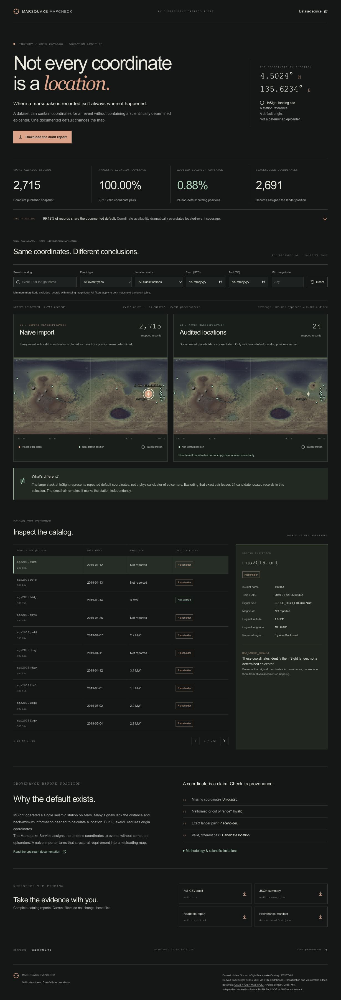

# Marsquake MapCheck

**Not every coordinate is a location.**

> **GitHub repository description:** A provenance-aware audit of placeholder coordinates in NASA InSight's Marsquake catalog, with side-by-side interactive Mars maps.
>
> **Suggested GitHub topics:** `marsquake`, `mars`, `nasa-insight`, `scientific-data`, `data-quality`, `data-provenance`, `geospatial`, `data-visualization`, `open-science`, `python`, `react`, `typescript`.

A focused scientific data-quality instrument for the InSight Marsquake Service catalog. A Python audit engine preserves the source data and explains every location classification; a static React application compares naive coordinate plotting with a provenance-aware map.



## The scientific problem

The [Marsquake Service documentation](https://service.earthscope.org/irisws/mars-event/docs/1/help/) explains that valid QuakeML origins require coordinates. Events without computed locations are therefore assigned the InSight lander pair: **4.5024° N, 135.6234° E**. These values must not be interpreted as determined epicenters.

The [Hugging Face dataset card](https://huggingface.co/datasets/juliensimon/insight-marsquake-catalog) calls all 2,715 rows “location estimates” and demonstrates `latitude.notna()` to identify located events. This checks structure, not scientific meaning. MapCheck makes the discrepancy visible without discarding or rewriting the original coordinates.

## Actual snapshot findings

Revision `6a14e70827fe23f9b2e31609ddcecce9d3219de4`, derived from the bundled real Parquet:

| Finding                                 |         Result |
| --------------------------------------- | -------------: |
| Catalog records                         |          2,715 |
| Valid coordinate pairs                  |          2,715 |
| Documented placeholder pairs            | 2,691 (99.12%) |
| Valid non-default positions             |     24 (0.88%) |
| Missing / invalid coordinate pairs      |          0 / 0 |
| Duplicate event identifiers             |              0 |
| Apparent location coverage              |        100.00% |
| Audited location coverage               |          0.88% |
| Relative reduction in apparent coverage |         99.12% |

These are **catalog records**, not a claim that every entry is a confirmed tectonic marsquake. Non-default coordinates are candidate computed positions under the documented convention; this tool does not independently verify their accuracy.

The left map plots all valid stored pairs, with one counted stack for repeated placeholder coordinates. The right map plots only valid non-default pairs. Both use the same global equirectangular projection, USGS MOLA raster, alignment and scale. The InSight crosshair remains a separate station reference in both panels.

## Quickstart

Prerequisites: **Node.js 22.12+** (tested with 22.22), **pnpm 12.3.4+**, **Python 3.11+** (tested with 3.12), and [uv](https://docs.astral.sh/uv/).

```bash
pnpm install --frozen-lockfile
pnpm dev
```

Open the local URL printed by Vite, normally `http://127.0.0.1:5173/`. The real processed snapshot and all assets are included, so no Python processing or catalog download is needed to start exploring. No API key, account, database or server application is required. After installing dependencies and preparing the data, local development and the built static application work without internet access. Serve the build over HTTP; opening `index.html` via `file://` is not supported because it fetches local JSON assets.

## Reproduce or refresh the audit

```bash
uv sync --locked

# Reproduce from the preserved, byte-exact source without network access:
uv run python -m mapcheck ingest \
  --input data/source/insight_marsquakes.parquet \
  --revision 6a14e70827fe23f9b2e31609ddcecce9d3219de4

# Fetch the latest published Hugging Face snapshot through its official client:
uv run python -m mapcheck ingest

# Fetch a specific remote revision:
uv run python -m mapcheck ingest \
  --revision 6a14e70827fe23f9b2e31609ddcecce9d3219de4

# Local CSV/Parquet using the documented catalog schema:
uv run python -m mapcheck ingest --input path/to/catalog.csv

# Generate reports only, without updating frontend data:
uv run python -m mapcheck audit --input path/to/catalog.csv --output reports/

uv run python -m mapcheck --help
```

`python -m mapcheck` also works directly after activating an environment containing the dependencies. Commands run from the repository root. Exit codes: 0 success; 1 source/schema/export failure with a readable message; 2 invalid CLI arguments. Remote ingestion inspects available files and refuses an unexpected Parquet layout. Local files must provide the 15 catalog columns listed in `mapcheck/schema.py`; extra fields are retained. `--revision` on a local file asserts provenance supplied by the operator and does not validate its identity remotely. Compare its SHA-256 to the recorded manifest when verifying a snapshot.

`ingest` preserves its input in `data/source/`, creates normalized browser data, and writes the reports and their frontend copies. Repeated processing is deterministic except explicitly volatile retrieval timestamps in manifest/summary metadata. Regeneration intentionally replaces generated artifacts; review them together. If the remote schema changes, inspect it before adapting the pipeline. Tests never depend on the remote service.

## Audit artifacts

- [Full per-record CSV audit](reports/audit.csv): original coordinates, classifications, explanations and mapping eligibility.
- [JSON summary](reports/audit-summary.json): derived counts, coverage, coordinate frequencies, signal-type breakdown, duplicates and snapshot metadata.
- [Readable audit report](reports/audit-report.md): findings, provenance, methodology and limitations.
- [Dataset manifest](reports/dataset-manifest.json): revision, input SHA-256, record counts, UTC timestamp and application/schema/rules versions.

The same complete-catalog files are downloadable in the application. UI filters never silently alter full-report exports.

## Explore

Search event ID or contributor name; filter by actual source signal type, inclusive UTC date range, location classification, or minimum magnitude. A magnitude threshold excludes missing magnitudes explicitly. Both maps and selection metrics update together, while full-catalog metrics stay fixed. Select a map marker or table entry to inspect its source values and audit rationale. A stack selection opens its corresponding table entries; “Show all filtered records” restores the full selection. Table pagination keeps all records accessible, including excluded events.

Semantic controls, visible focus indicators, keyboard-operable map symbols, descriptive map text, textual findings, a complete table alternative and reduced-motion support are included. At narrow widths the maps stack in the same order. [Mobile screenshot](docs/mobile.jpg).

## Production build

```bash
pnpm install --frozen-lockfile
pnpm build
pnpm preview
```

Deploy **`web/dist/`** to any static host. Relative asset paths support a subdirectory such as GitHub Pages. Build command is `pnpm install --frozen-lockfile && pnpm build`, output directory `web/dist`. No hosting integration or credentials are required by the application. A static host may serve compressed assets for faster transfers. No runtime requests leave the hosting origin unless a visitor follows an attribution link. Publishing and cloud infrastructure are intentionally outside this local implementation.

## Tests and verification

```bash
uv sync --locked
uv run pytest -q
uv run ruff check mapcheck tests
pnpm install --frozen-lockfile
pnpm test
pnpm typecheck
pnpm build
```

Verified locally: **26 Python tests**, **9 frontend tests**, Python static checks, TypeScript checking, and the production Vite build. The complete pinned remote-ingestion CLI was also executed successfully. Tests cover numeric boundaries, exact defaults versus nearby coordinates, missing/invalid values, duplicate IDs, deterministic output, source preservation, export consistency, real catalog regressions, map eligibility, the independent station layer, shared filters, missing magnitudes, stable selection, stack keyboard interaction and download targets.

Manual browser smoke checks covered desktop and 390-pixel mobile rendering, shared search, map alignment and mobile stacking, with no console warnings/errors observed. Screenshots are included above. CI repeats local tests, typechecking and build with the bundled source snapshot; hosted CI execution is not claimed.

## Implementation

- Python 3.11+, pandas, PyArrow, huggingface_hub; pytest and Ruff.
- React, TypeScript, Vite, Tailwind CSS and Lucide; Vitest and Testing Library.
- Pure Python classification independent of the UI; static JSON and reports; SVG equirectangular maps.
- `mapcheck/`: source, schema, normalization, classification, summaries, exports, provenance and CLI.
- `web/`: responsive browser application and locally bundled data/maps.
- `tests/`: offline Python regression tests; frontend tests live beside components.
- `docs/`: methodology, limitations, attribution and verified screenshots.

## Scientific boundaries and licensing

Read the [methodology](docs/methodology.md), [scientific limitations](docs/scientific-limitations.md), and [data sources](docs/data-sources.md). This dataset does not expose dedicated location-quality or uncertainty fields; no quality scores or inferred positions are fabricated. A real event at exactly the default pair cannot be distinguished using these fields alone. Global marker sizes do not encode uncertainty, magnitude or physical event size. There is no prediction, live monitoring, waveform processing, machine learning, 3D globe, database or account system.

Original application and processing code: [MIT](LICENSE). Dataset: **Julien Simon, InSight Marsquake Catalog (2026), CC BY 4.0**, based on NASA InSight SEIS / Marsquake Service via IRIS (EarthScope). Changes: normalization, coordinate classification, reporting and visualization. The [original dataset card](data/source/dataset-card.md) and [citation](docs/data-sources.md) are retained. The bundled USGS/NASA MGS MOLA basemap is public-domain government imagery, with use constraints “None” in publisher metadata; provenance and alignment are documented separately. MIT does not relicense the dataset or third-party assets. No official endorsement is implied.
